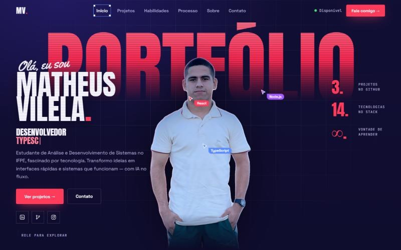
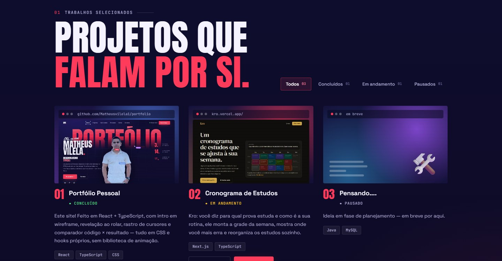
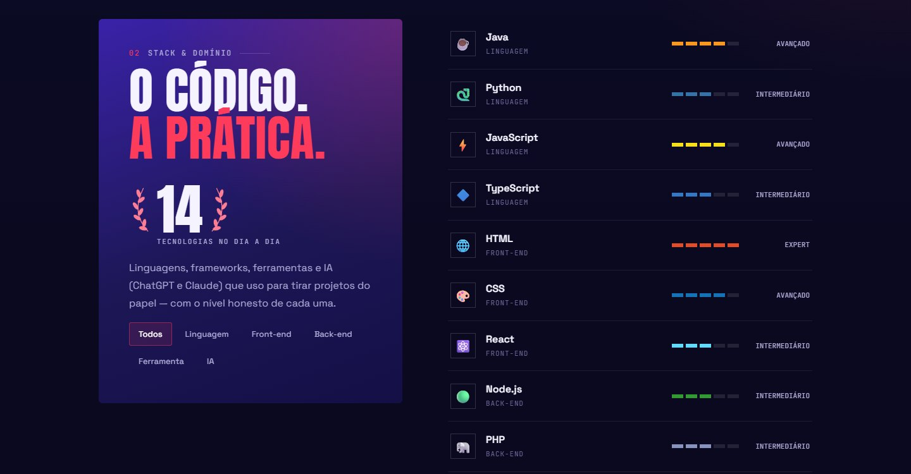
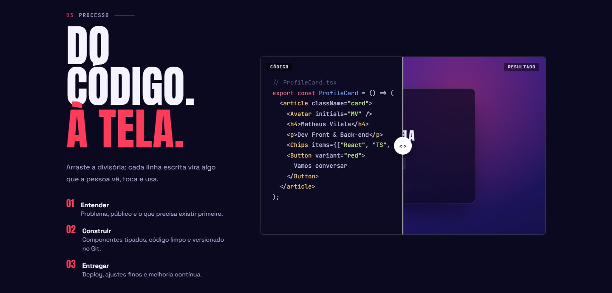
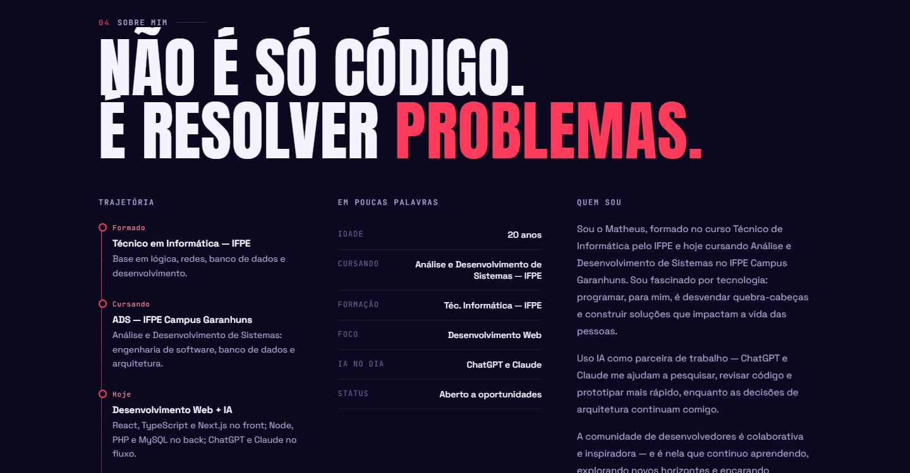
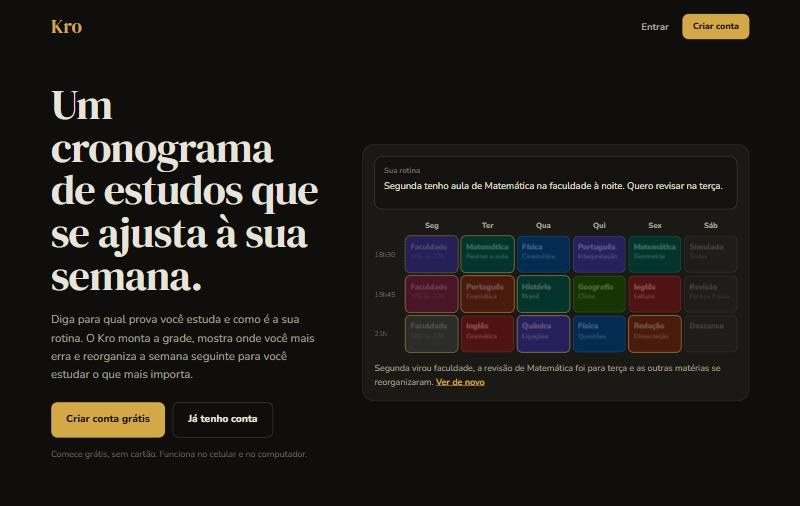
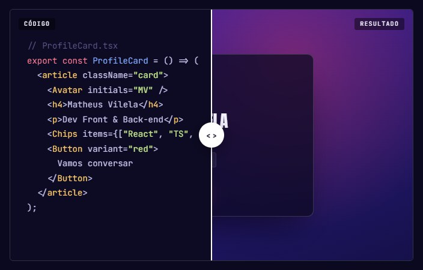
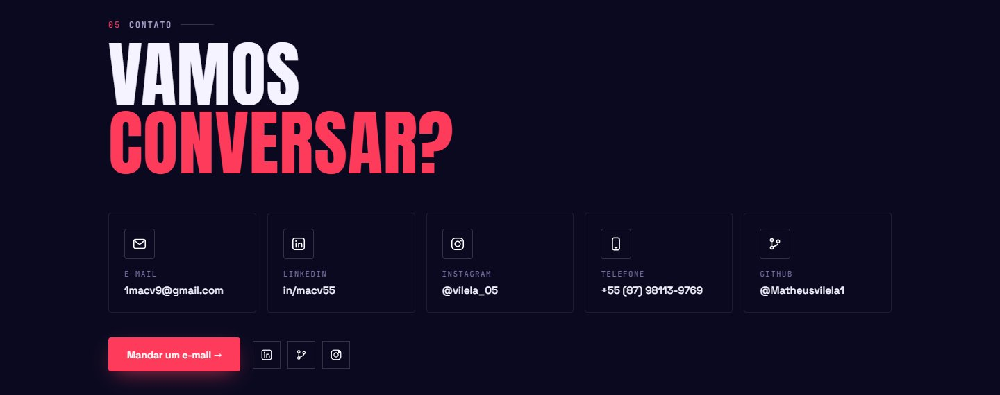

<div align="center">



**Não é só código. É resolver problemas.**

Estudante de **Análise e Desenvolvimento de Sistemas** no **IFPE Campus Garanhuns**,
técnico em informática e fascinado por tecnologia.

[](https://github.com/Matheusvilela1/portfolio)
[](https://kro.vercel.app/)
[](https://www.linkedin.com/in/macv55/)
[](mailto:1macv9@gmail.com)

</div>

---

## `$ cat sobre.ts`

```ts
const matheus = {
  formacao:  "Técnico em Informática — IFPE",
  cursando:  "Análise e Desenvolvimento de Sistemas — IFPE Campus Garanhuns",
  foco:      ["Desenvolvimento Web", "Front-end", "Back-end"],
  agora:     "construindo o Kro, um cronograma de estudos que se reorganiza sozinho",
  ia:        ["ChatGPT", "Claude"],   // parceiros de pesquisa, revisão e protótipo
  status:    "aberto a oportunidades",
};
```

Programar, para mim, é desvendar quebra-cabeças e construir soluções que fazem diferença na vida das pessoas. A IA entra no fluxo para pesquisar, revisar código e prototipar mais rápido. As decisões de arquitetura continuam comigo.

## `$ stack --all`

<table>
  <tr>
    <td><b>Linguagens</b></td>
    <td>
      
      
      
      
    </td>
  </tr>
  <tr>
    <td><b>Front-end</b></td>
    <td>
      
      
      
    </td>
  </tr>
  <tr>
    <td><b>Back-end</b></td>
    <td>
      
      
      
    </td>
  </tr>
  <tr>
    <td><b>Ferramentas</b></td>
    <td>
      
      
    </td>
  </tr>
  <tr>
    <td><b>IA no dia a dia</b></td>
    <td>
      
      
    </td>
  </tr>
</table>

## `$ open portfolio`

Meu portfólio é feito em **React + TypeScript**, com intro em wireframe, revelação ao rolar no estilo Figma, cursores "colaborativos" e um comparador código × resultado. É tudo CSS e hooks próprios, sem nenhuma biblioteca de animação.

<a href="https://github.com/Matheusvilela1/portfolio">
  
</a>

<table>
  <tr>
    <td width="50%">
      
      <p align="center"><sub><b>01 · Projetos</b>: filtros por status e miniatura de cada site</sub></p>
    </td>
    <td width="50%">
      
      <p align="center"><sub><b>02 · Habilidades</b>: o stack com o nível honesto de cada uma</sub></p>
    </td>
  </tr>
  <tr>
    <td width="50%">
      
      <p align="center"><sub><b>03 · Processo</b>: arraste a divisória do código até a tela</sub></p>
    </td>
    <td width="50%">
      
      <p align="center"><sub><b>04 · Sobre</b>: trajetória, fatos rápidos e quem eu sou</sub></p>
    </td>
  </tr>
</table>

## `$ ls projetos/`

<table>
  <tr>
    <td width="50%" valign="top">
      <a href="https://kro.vercel.app/"></a>
      <h3>🚀 Kro · cronograma de estudos</h3>
      <p>Você diz para qual prova estuda e como é a sua rotina. Ele monta a grade da semana, mostra onde você mais erra e reorganiza os estudos sozinho.</p>
      <p>
        
        
        
      </p>
      <a href="https://kro.vercel.app/">Abrir o site</a> · <a href="https://github.com/Matheusvilela1/cronograma">Repositório</a>
    </td>
    <td width="50%" valign="top">
      <a href="https://github.com/Matheusvilela1/portfolio"></a>
      <h3>🌐 Portfólio pessoal</h3>
      <p>Visual editorial com animações em wireframe, revelação ao rolar e rastro de cursores, tudo sem biblioteca de animação.</p>
      <p>
        
        
        
      </p>
      <a href="https://github.com/Matheusvilela1/portfolio">Repositório</a>
    </td>
  </tr>
</table>

## `$ history`

```diff
+ Formado    Técnico em Informática — IFPE
+ Cursando   ADS — IFPE Campus Garanhuns
+ Hoje       Desenvolvimento Web + IA (React, TypeScript, Next.js, Node, PHP, MySQL)
! Próximo    procurando um time para crescer e entregar produtos de verdade
```

## `$ ./contato.sh`

<div align="center">



[](https://www.linkedin.com/in/macv55/)
[](https://www.instagram.com/vilela_05/)
[](mailto:1macv9@gmail.com)

<sub>● disponível para novos projetos · feito com TypeScript e um pouco de IA</sub>

</div>
